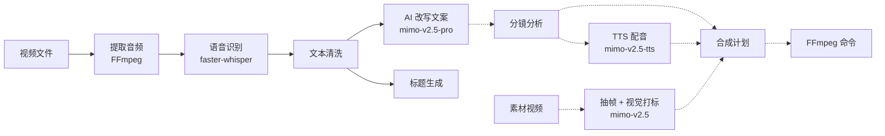

# MiMo Video Workflow

[中文](#中文) | [English](#english)

---

## 中文

基于 MiMo 大模型的短视频（信息流视频）制作工作流工具：把视频转写、文案改写、标题生成，以及分镜、素材打标、配音、合成规划串成一条可重复的流程。

### 功能

**已接入 GUI / CLI 的功能**

- **批量处理视频**：拖拽或添加文件 / 文件夹（支持 `.mp4 .avi .mov .mkv .wmv .flv .webm`），按顺序批量处理
- **音频提取**：使用 FFmpeg（优先用 `imageio-ffmpeg` 自带的版本）
- **本地语音识别**：faster-whisper，本地模型，CPU int8 模式，可选 `tiny / base / small / medium / large-v3`
- **文本清洗**：去除口头禅、重复字符和多余符号
- **AI 文案改写**：结合产品名称、卖点和自定义要求，改写为口播文案
- **标题生成**：每个视频生成 5 个候选标题
- **AI 控制台**：在 GUI 中用命令或自然语言修改设置、添加视频、开始 / 停止任务；清空、批量生成等操作需要确认
- **长期记忆**：记住风格、禁用表达、产品信息、提示词预设和最近一次任务
- **素材抽帧与视觉分析**：从视频中抽帧，再用视觉模型（默认 `mimo-v2.5`）分析素材类型和画面内容

**以 Python 模块形式提供（尚未接入界面）**

- `storyboard_analyzer.py`：把参考文案拆成分镜 JSON（镜头文案、配音文本、时长、视觉标签、素材需求等）
- `material_catalog.py`：批量扫描素材目录，生成素材卡片目录
- `tts_interfaces.py`：MiMo TTS 按分镜生成配音（默认 `mimo-v2.5-tts`，输出 mp3）
- `media_assembler.py`：按标签把分镜匹配到素材和配音，生成合成计划，并生成 FFmpeg 命令（只生成命令，不会自动执行）
- `video_fetcher.py` / `video_downloader.py`：基于 yt-dlp 获取视频信息、下载视频或音频（可配置代理）

### 流程概览



实线为 GUI 中已打通的流程，虚线为模块已提供、尚未接入界面的部分。详细设计见 [`docs/FINAL_PRODUCT_IMPLEMENTATION.md`](docs/FINAL_PRODUCT_IMPLEMENTATION.md)。

### 环境要求

- Python 3.9+（推荐 3.11 / 3.12），需要带 Tkinter
- FFmpeg：`imageio-ffmpeg` 会自带一个；也可以自己安装（如 `brew install ffmpeg`）
- 一个兼容 OpenAI 接口的 API Key（默认使用 MiMo）
- 语音识别跑在 CPU 上（`device="cpu"`, `compute_type="int8"`），不需要 GPU

### 安装

```bash
git clone https://github.com/inkCau1o-hub/mimo-video-workflow.git
cd mimo-video-workflow
python3 -m venv .venv
source .venv/bin/activate          # Windows: .venv\Scripts\activate
pip install --upgrade pip
pip install -r requirements.txt
```

**下载语音识别模型**（必需：程序只读取本地模型，不会自动下载）：

```bash
python download_models.py tiny base          # 默认下载 tiny 和 base
python download_models.py medium             # GUI 默认选中 medium
python download_all_models.py                # 下载全部：tiny/base/small/medium/large-v3
```

模型从 Hugging Face 的 `Systran/faster-whisper-<size>` 下载到 `models/faster-whisper-<size>/`。

### 配置

可以在 GUI 中填写并点击“保存配置”，也可以用环境变量（优先于配置文件）：

| 配置项 | 环境变量（按优先级） | 默认值 |
| --- | --- | --- |
| API Key | `API_KEY` / `OPENAI_API_KEY` / `MIMO_API_KEY` / `DEEPSEEK_API_KEY` | 空（必填） |
| Base URL | `API_BASE_URL` / `OPENAI_BASE_URL` / `MIMO_BASE_URL` | `https://token-plan-cn.xiaomimimo.com/v1` |
| 文本模型 | `API_MODEL` / `OPENAI_MODEL` / `MIMO_MODEL` | `mimo-v2.5-pro` |
| 视觉模型 | `VISION_API_MODEL` / `MIMO_VISION_MODEL` | `mimo-v2.5` |
| TTS 模型 | `TTS_API_MODEL` / `MIMO_TTS_MODEL` | `mimo-v2.5-tts` |
| TTS 音色 | `TTS_VOICE` / `MIMO_TTS_VOICE` | `mimo_default` |
| 输出目录 | `OUTPUT_DIR` | `~/Documents/短视频文案输出` |
| 模型目录 | `MODELS_DIR` | `./models` |
| 代理（yt-dlp） | `PROXY_URL` | 空 |
| 配置文件路径 | `VIDEO_SCRIPT_CONFIG_PATH` | 见下方 |
| 记忆文件路径 | `VIDEO_SCRIPT_MEMORY_PATH` | 与配置文件同目录的 `memory.json` |

配置文件 `config.json` 的默认位置：

- macOS：`~/Library/Application Support/短视频文案生成工具/`
- Windows：`%APPDATA%\短视频文案生成工具\`
- Linux：`$XDG_CONFIG_HOME/短视频文案生成工具/`（默认 `~/.config/...`）

配置文件里的 API Key 是明文保存的，不要提交到仓库。

```bash
export API_KEY="your-api-key"
export API_MODEL="mimo-v2.5-pro"
```

### 使用

**GUI（推荐）**

```bash
python main.py --gui
```

或使用启动脚本：

- macOS：`./启动.command`（自动创建 `.venv`、安装依赖并启动 GUI；需要 zsh）
- Windows：双击 `启动.bat`（检查 Python、安装缺少的依赖，然后启动 GUI）

操作步骤：添加视频 → 填写产品名称、卖点和要求 → 选择 Whisper 模型和选项 → 点击“开始生成”。在 AI 控制台输入 `帮助` 可以查看所有命令。

输出文件（在输出目录中）：

- `原文稿_<视频名>.txt`：识别出的原文（勾选“保存原文”时）
- `clean_text_<视频名>.txt`：清洗后的文本（勾选“保存清洗文本”时）
- `修改文稿_<视频名>.txt`：AI 改写后的文案
- `titles_<视频名>.txt`：候选标题（勾选“生成标题”时）

**CLI**

```bash
python main.py          # 或 python main.py --cli
```

按提示输入视频路径、产品关键词和 Whisper 模型（默认 `base`），结果写入 `<输出目录>/output.txt`。

### 项目结构

| 文件 | 说明 |
| --- | --- |
| `main.py` | 入口，`--gui` 启动界面，默认进入命令行模式 |
| `gui.py` | Tkinter 界面、批量任务、AI 控制台 |
| `config.py` | 配置加载（环境变量 > 配置文件 > 默认值）和保存 |
| `ai_client.py` | OpenAI 兼容的文本 / 图像客户端 |
| `audio_extractor.py` | 用 FFmpeg 从视频中提取音频 |
| `speech_to_text.py` | faster-whisper 本地语音识别 |
| `ai_rewriter.py` | AI 文案改写 |
| `script_generator.py` | 口播脚本生成（含多版本生成） |
| `title_generator.py` | 标题生成 |
| `multimodal_interfaces.py` | 抽帧和视觉素材分析 |
| `material_catalog.py` | 素材目录扫描和打标 |
| `storyboard_analyzer.py` | 文案分镜分析 |
| `tts_interfaces.py` | MiMo TTS 客户端 |
| `media_assembler.py` | 标签匹配、合成计划、FFmpeg 命令生成 |
| `production_schema.py` | 项目、分镜、素材、配音、合成计划等数据结构 |
| `app_memory.py` | AI 控制台的长期记忆 |
| `video_fetcher.py` / `video_downloader.py` | 基于 yt-dlp 获取和下载视频 |
| `download_models.py` / `download_all_models.py` | 下载 faster-whisper 模型 |
| `test_stt.py` / `test_gpu.py` / `debug_stt.py` | 本地调试脚本（里面的文件路径是写死的） |
| `启动.command` / `启动.bat` | macOS / Windows 启动脚本 |
| `使用说明.md` | 中文使用说明 |
| `docs/` | 产品设计文档 |

### 参与贡献

欢迎提交 Issue 和 Pull Request。建议：

- 一个 PR 只做一件事，并说明改了哪些文件
- 提交前至少跑一遍 `python -m compileall .`
- 不要提交 API Key、`config.json`、模型文件或媒体文件（已写在 `.gitignore` 中）

### 许可证

[MIT](LICENSE)

---

## English

A MiMo-powered workflow tool for short-form / feed video production. It chains video transcription, copy rewriting and title generation, and provides building blocks for storyboarding, material tagging, voiceover and assembly planning, so the whole process is repeatable.

### Features

**Available in the GUI / CLI**

- **Batch video processing**: drag and drop, or add files or folders (`.mp4 .avi .mov .mkv .wmv .flv .webm`), processed one after another
- **Audio extraction** with FFmpeg (the binary bundled with `imageio-ffmpeg` is used first)
- **Local speech-to-text** with faster-whisper: local models, CPU int8, sizes `tiny / base / small / medium / large-v3`
- **Text cleaning**: removes filler words, repeated characters and stray symbols
- **AI copy rewriting** into voiceover scripts, based on product name, selling points and custom requirements
- **Title generation**: 5 candidate titles per video
- **AI console**: change settings, add videos and start or stop jobs with commands or natural language; clearing and batch runs ask for confirmation first
- **Long-term memory** for styles, blocked phrases, product info, prompt presets and the last task
- **Frame extraction and visual material analysis** with a vision model (default `mimo-v2.5`)

**Provided as Python modules (not yet in the UI)**

- `storyboard_analyzer.py`: splits reference copy into storyboard JSON (shot text, TTS text, duration, visual tags, material requirements, etc.)
- `material_catalog.py`: scans a material folder and builds a catalog of tagged assets
- `tts_interfaces.py`: MiMo TTS per storyboard shot (default `mimo-v2.5-tts`, mp3 output)
- `media_assembler.py`: matches shots to assets and voiceovers by tags, builds an assembly plan and an FFmpeg command (the command is generated, not run)
- `video_fetcher.py` / `video_downloader.py`: yt-dlp-based video info lookup and video or audio download (proxy supported)

### Pipeline

See the mermaid diagram in the Chinese section above. Solid lines are wired into the GUI; dashed lines are available as modules. Design notes are in [`docs/FINAL_PRODUCT_IMPLEMENTATION.md`](docs/FINAL_PRODUCT_IMPLEMENTATION.md) (Chinese).

### Requirements

- Python 3.9+ (3.11 / 3.12 recommended) with Tkinter
- FFmpeg (bundled through `imageio-ffmpeg`, or install your own, e.g. `brew install ffmpeg`)
- An OpenAI-compatible API key (MiMo by default)
- Speech recognition runs on the CPU (`device="cpu"`, `compute_type="int8"`); no GPU required

### Installation

```bash
git clone https://github.com/inkCau1o-hub/mimo-video-workflow.git
cd mimo-video-workflow
python3 -m venv .venv
source .venv/bin/activate          # Windows: .venv\Scripts\activate
pip install --upgrade pip
pip install -r requirements.txt
```

**Download Whisper models.** This step is required: models are only loaded from local disk and are never downloaded automatically.

```bash
python download_models.py tiny base          # default: tiny and base
python download_models.py medium             # the GUI selects medium by default
python download_all_models.py                # all of tiny/base/small/medium/large-v3
```

Models are downloaded from Hugging Face `Systran/faster-whisper-<size>` into `models/faster-whisper-<size>/`.

### Configuration

Set values in the GUI and click “保存配置” (Save config), or use environment variables, which take priority over the config file:

| Setting | Env vars (in priority order) | Default |
| --- | --- | --- |
| API key | `API_KEY` / `OPENAI_API_KEY` / `MIMO_API_KEY` / `DEEPSEEK_API_KEY` | empty (required) |
| Base URL | `API_BASE_URL` / `OPENAI_BASE_URL` / `MIMO_BASE_URL` | `https://token-plan-cn.xiaomimimo.com/v1` |
| Text model | `API_MODEL` / `OPENAI_MODEL` / `MIMO_MODEL` | `mimo-v2.5-pro` |
| Vision model | `VISION_API_MODEL` / `MIMO_VISION_MODEL` | `mimo-v2.5` |
| TTS model | `TTS_API_MODEL` / `MIMO_TTS_MODEL` | `mimo-v2.5-tts` |
| TTS voice | `TTS_VOICE` / `MIMO_TTS_VOICE` | `mimo_default` |
| Output dir | `OUTPUT_DIR` | `~/Documents/短视频文案输出` |
| Models dir | `MODELS_DIR` | `./models` |
| Proxy (yt-dlp) | `PROXY_URL` | empty |
| Config file | `VIDEO_SCRIPT_CONFIG_PATH` | see below |
| Memory file | `VIDEO_SCRIPT_MEMORY_PATH` | `memory.json` next to the config file |

Default `config.json` location: macOS `~/Library/Application Support/短视频文案生成工具/`, Windows `%APPDATA%\短视频文案生成工具\`, Linux `$XDG_CONFIG_HOME/短视频文案生成工具/` (default `~/.config/...`). The API key is stored there in plain text, so never commit it.

### Usage

**GUI (recommended)**

```bash
python main.py --gui
```

Or use a launcher script:

- macOS: `./启动.command` (creates `.venv`, installs dependencies and starts the GUI; needs zsh)
- Windows: double-click `启动.bat` (checks Python, installs missing packages and starts the GUI)

Add videos, fill in the product name, selling points and requirements, pick a Whisper model and options, then click “开始生成” (Start). Type `帮助` (help) in the AI console to list all commands.

Output files in the output directory: `原文稿_<name>.txt` (raw transcript), `clean_text_<name>.txt` (cleaned text), `修改文稿_<name>.txt` (rewritten copy), `titles_<name>.txt` (titles). Some of these depend on the options you tick.

**CLI**

```bash
python main.py          # or: python main.py --cli
```

Enter the video path, product keywords and Whisper model size (default `base`) when prompted. The result is written to `<output dir>/output.txt`.

### Project structure

See the table in the Chinese section above. In short: `main.py` / `gui.py` are the entry points, `config.py` handles settings, the `*_interfaces.py` / `ai_*.py` / `*_generator.py` files wrap the AI APIs, `speech_to_text.py` + `audio_extractor.py` handle transcription, `storyboard_analyzer.py` / `material_catalog.py` / `media_assembler.py` / `production_schema.py` make up the production pipeline, and `test_*.py` / `debug_stt.py` are local debug scripts with hard-coded paths.

### Contributing

Issues and pull requests are welcome. Please keep each PR focused, run `python -m compileall .` before submitting, and never commit API keys, `config.json`, model weights or media files.

### License

[MIT](LICENSE)
