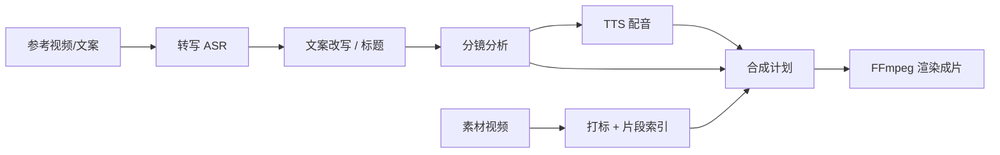

# MiMo Video Workflow

[中文](#中文) | [English](#english)

开源短视频（信息流）生产工作流：参考转写 → 文案改写 → 分镜 → 素材打标/选段 → TTS 配音 → 合成导出。  
主界面是 **React/Vite 桌面前端 + 本地 Python HTTP 后端**；另保留旧版 Tkinter GUI / CLI。

---

## 中文

### 现状（请先读）

- **主路径**：`apps/desktop`（React）通过 HTTP 调用 `backend/`（默认 `127.0.0.1:8765`）。
- **阶段一「可控编辑」已功能验收通过**（镜头/字幕/历史恢复/导出等）；详见 [`docs/阶段一验收报告.md`](docs/阶段一验收报告.md)。
- **阶段二「成片质量」实施中**：片段推荐、混音、字幕时间与留白等已有验收文档；主体裁剪改进、自动品牌词、转场/封面模板、语音级精确对齐等仍未完成。见 [`docs/发展路线与验收台账.md`](docs/发展路线与验收台账.md)。
- **macOS / Windows 开发版壳**是原型，不是可分发安装包（无签名、无打包 sidecar）。
- **旧版 Tkinter**（`python main.py --gui`）仍可用，侧重批量转写/改写/标题；完整流水线请用桌面开发版。
- 仓库中 **没有** `text_cleaner.py`；文案页不做独立「文本清洗」步骤。
- 上传素材 **不会自动打标**；需在素材库手动触发打标 / 片段索引。

### 功能概览

**桌面开发版（React + backend）已接入**

| 页面 | 能力 |
| --- | --- |
| 产品资料 | 产品名、卖点等画像，供改写与标题使用 |
| 参考转写 | 上传/校验参考视频，本地 faster-whisper 转写，或直接粘贴/保存参考文案 |
| 文案 | AI 改写、保存文案、生成候选标题 |
| 分镜 | AI 拆分镜头，可编辑镜头；编辑历史撤销/重做；片段推荐入口 |
| 素材库 | 上传素材视频，打标分类，片段索引与推荐 |
| 配音 | 按分镜生成 / 单段重生成 TTS，试听 |
| 合成 / 成片 | 生成合成计划并 **实际渲染** mp4；音量/音乐/人声压低音乐；封面渲染入口；结果页查看成片 |
| 活动与任务 | 多 activity、异步 job、取消、日志与状态面板；Agent 控制台发命令 |

**底层模块（由 backend 调用）**

- `speech_to_text.py` / `audio_extractor.py`：本地 ASR  
- `ai_rewriter.py` / `title_generator.py` / `script_generator.py`：文案与标题  
- `storyboard_analyzer.py`：分镜  
- `material_catalog.py` / `material_segments.py` / `multimodal_interfaces.py`：素材卡与片段  
- `tts_interfaces.py`：MiMo TTS  
- `media_assembler.py` + `media_render.py`：计划与 FFmpeg 渲染  
- `audio_mix.py` / `shot_timing.py` / `visual_edit.py` / `cover_render.py`：混音、字幕时间、画面编辑、封面  
- `workflow_state.py` / `production_schema.py`：项目状态与数据结构  
- `video_fetcher.py` / `video_downloader.py`：yt-dlp（偏旧流程/工具向）

### 流程示意



设计说明见 [`docs/FINAL_PRODUCT_IMPLEMENTATION.md`](docs/FINAL_PRODUCT_IMPLEMENTATION.md)。

### 环境要求

- **Python 3.10+**（开发版安装脚本按 3.10+ 检查；旧 Tkinter 路径也可用 3.9+）
- **Node.js + npm**（仅桌面前端需要）
- **FFmpeg / ffprobe**（`imageio-ffmpeg` 可作兜底；Windows 开发版要求系统里能跑通 ffmpeg）
- 本地 Whisper 模型目录（程序读本地 `models/`，**不会**在业务路径里自动下载）
- 使用文案改写 / 配音等功能前，需自行配置多模态大模型 API（见「配置」）

### 安装

```bash
git clone https://github.com/inkCau1o-hub/mimo-video-workflow.git
cd mimo-video-workflow
```

**macOS（推荐开发版一键脚本）**

```bash
./安装环境.command          # 创建 .venv、pip install、前端 npm install
python download_models.py tiny base   # 或 medium；GUI/转写默认常选 medium
python download_models.py medium
# 可选：先构建原生壳
./macos-app/build_dev_app.sh
```

**Windows**

```powershell
powershell -NoProfile -ExecutionPolicy Bypass -File .\windows-app\安装环境.ps1
# 可选：-BuildFrontend  -RunSmoke
python download_models.py tiny base
python download_models.py medium
```

Windows 使用 `.venv-windows`（或已有 Windows `.venv`），不会复用 macOS 的 `.venv`。

**手动安装**

```bash
python3 -m venv .venv
source .venv/bin/activate          # Windows: .venv\Scripts\activate 或 .venv-windows\Scripts\activate
pip install -r requirements.txt
cd apps/desktop && npm install && cd ../..
```

`requirements.txt`：`yt-dlp`、`faster-whisper`、`requests`、`imageio-ffmpeg`、`huggingface-hub`、`tkinterdnd2`、`Pillow`（图片素材转正、转 sRGB），以及 Windows/Linux 上读 HEIC 用的 `pillow-heif`（Mac 用系统自带的 `sips`）。后端是标准库 `http.server`，无额外 Web 框架依赖。

配音字幕对齐（可选）：配音生成后会用强制对齐给字幕取实测时间。对齐在单独的 Python 环境里运行（WhisperX + PyTorch），不装进主程序。在配置文件里写 `aligner_python`（该环境的 python）、`align_model_dir`（中文 wav2vec2 模型目录）、`align_nltk_data`（NLTK 分句数据），或使用同名环境变量 `MIMO_ALIGNER_PYTHON`、`MIMO_ALIGN_MODEL_DIR`、`MIMO_ALIGN_NLTK_DATA`。没有配置时，字幕按字数估算。实测数据见 [docs/WhisperX中文对齐实测.md](docs/WhisperX中文对齐实测.md)。

### 配置

文案改写、配音等云端能力需要自行配置多模态大模型 API；未配置时相关功能不可用。具体字段以应用内设置为准，请勿把密钥提交到仓库。

| 配置项 | 环境变量 | 默认 |
| --- | --- | --- |
| 输出目录 | `OUTPUT_DIR` | `~/Documents/短视频文案输出` |
| 模型目录 | `MODELS_DIR` | `./models` |
| 代理（yt-dlp） | `PROXY_URL` | 空 |
| 配置 / 记忆文件 | `VIDEO_SCRIPT_CONFIG_PATH` / `VIDEO_SCRIPT_MEMORY_PATH` | 见下 |

默认 `config.json`：macOS `~/Library/Application Support/短视频文案生成工具/`，Windows `%APPDATA%\短视频文案生成工具\`，Linux `$XDG_CONFIG_HOME/短视频文案生成工具/`。  
本地配置文件请勿提交到仓库。

### 使用

#### 桌面开发版（推荐）

**分进程启动**

```bash
# 终端 1
python -m backend.server --host 127.0.0.1 --port 8765

# 终端 2
cd apps/desktop
npm run dev          # http://127.0.0.1:5173 ，后端默认 http://127.0.0.1:8765
```

可用环境变量 `VITE_BACKEND_URL` 覆盖后端地址。启动参数示例：`?auto_open=latest&start_page=voiceover`（直接进入信息流剪辑的配音页）。

### 统一启动器：信息流剪辑与 AI 动画

打开后先到首页，可选「信息流剪辑」或「AI 动画」，顶栏随时切换，两边项目和数据互不相通。`?module=feed|animation|home` 可直接打开指定功能，默认回到上次使用的功能。

AI 动画是独立的私有仓库，以 git 子模块挂在 `modules/ai-animation`：有访问权限时 `git clone --recursive` 一次拿到两边，安装环境脚本也会自动取出子模块。查找顺序是环境变量 `MIMO_AI_ANIMATION_DIR`、已取出的 `modules/ai-animation`、本仓库旁边的 `../ai-animation`（自己开发 AI 动画时用这份工作副本，安装脚本此时不再取子模块）。端口用 `MIMO_AI_ANIMATION_PORT`，默认读取它的 `launcher.json`。

后端在第一次进入 AI 动画时按 `launcher.json` 启动它的服务（`GET /modules`、`POST /modules/animation/start|stop|restart`），退出时连同子进程一起关闭；目录或依赖缺失时首页对应卡片显示原因，信息流剪辑照常可用。

模型密钥只在 MiMo 配一次：每次启动 AI 动画时，后端重新读取 MiMo 的设置（环境变量优先，其次配置文件），以 `MIMO_API_KEY`、`MIMO_BASE_URL`、`MIMO_MODEL`、`MIMO_VISION_MODEL` 环境变量传给它；不经过前端、不写进状态接口和日志。设置改了之后，AI 动画页面顶部会提示「重启 AI 动画后生效」。

**macOS 开发壳**

```bash
./macos-app/build_dev_app.sh
open -n "macos-app/build/MiMo Workflow Dev.app"
# 或: ./启动开发版App.command
```

壳会按需拉起后端 `8765` 与 Vite `5173`，日志在 `macos-app/build/logs/`。`.app` 必须留在项目树内。

**Windows 开发启动**

```powershell
powershell -NoProfile -ExecutionPolicy Bypass -File .\windows-app\启动开发版.ps1
# 可选: -BackendPort 8766 -FrontendPort 5174 -NoBrowser -SmokeOnly
```

端口占用会明确失败（不自动换端口）。仅前端：`start-frontend.bat` 或 `-FrontendOnly`。

#### 旧版 Tkinter / CLI

```bash
python main.py --gui
# 或 ./启动.command  /  启动.bat

python main.py --cli
```

### 测试（摘录）

```bash
python -m unittest discover -s tests -p 'test_*.py'
python tests/frontend_prototype_smoke.py
python tests/backend_api_smoke.py
cd apps/desktop && npm test && npm run build
```

Windows 启动器可靠性：`windows-app/tests/Test-Reliability.ps1`（可用 `-Integration`）。  
`tests/live_*.py` 为可选联调测试，默认冒烟不跑。

### 项目结构

```text
apps/desktop/          React + Vite 开发版前端
backend/               本地 HTTP API（server / workflow_api / project_store / jobs / editor_history）
macos-app/             macOS WKWebView 开发壳
windows-app/           Windows PowerShell 安装与启动脚本
docs/                  产品设计与分阶段验收
tests/                 Python / 冒烟测试
*.py                   流水线模块与旧 GUI（gui.py / main.py）
安装环境.command / 启动开发版App.command / 启动.command / 启动.bat
```

更多前端约定见 [`apps/desktop/README.md`](apps/desktop/README.md)；平台壳见 [`macos-app/README.md`](macos-app/README.md)、[`windows-app/README.md`](windows-app/README.md)。

### 安全与仓库约定

- 不要提交 `config.json`、本地密钥文件、模型权重、媒体与 `.venv`（见 `.gitignore`）。
- 后端仅监听本机回环，并对允许的 Origin 做 CORS 校验。
- 成片输出限制在项目目录内的 `.mp4`；渲染失败或取消不应覆盖已有成片。

### 参与贡献

- 一个 PR 只做一件事；提交前至少 `python -m compileall .`，改前端时跑 `npm test` / `npm run build`。
- 阶段目标与验收门槛以 `docs/发展路线与验收台账.md` 为准，勿把单项功能验证写成「整阶段完成」。

### 许可证

[MIT](LICENSE)

---

## English

Open-source short-form / feed-video production workflow: reference transcription → copy rewrite → storyboard → material tagging/segments → TTS → assembly export.  
The **primary UI** is a **React/Vite desktop frontend** talking to a **local Python HTTP backend**. A legacy Tkinter GUI and CLI remain available.

### Status (read first)

- **Main path**: `apps/desktop` → `backend/` over HTTP (default `127.0.0.1:8765`).
- **Stage 1 “controllable editing”** is feature-accepted (shots, subtitles, history restore, export). See [`docs/阶段一验收报告.md`](docs/阶段一验收报告.md) (Chinese).
- **Stage 2 “output quality”** is in progress: segment recommendations, audio mix, subtitle timing/padding have acceptance notes; improved subject framing, auto brand-term detection, transitions/cover templates, and speech-level alignment are **not** done. Roadmap: [`docs/发展路线与验收台账.md`](docs/发展路线与验收台账.md).
- **macOS / Windows dev shells** are prototypes, not signed installers.
- **Legacy Tkinter** (`python main.py --gui`) still works for batch transcription/rewrite/titles; use the desktop app for the full pipeline.
- There is **no** `text_cleaner.py` and **no** dedicated “text cleaning” step on the copywriting page.
- Material uploads **do not** auto-tag; tagging / segment indexing must be triggered in the material library.

### Features

**Desktop app (React + backend)** covers product profile, reference transcription, copy rewrite & titles, storyboard editing with history, material tagging & segment recommendations, per-shot TTS, assembly planning and **real FFmpeg render**, audio settings / music, cover render hooks, multi-activity jobs, and an agent console.

**Core Python modules** (invoked by the backend): `speech_to_text`, `ai_rewriter` / `title_generator`, `storyboard_analyzer`, `material_catalog` / `material_segments`, `tts_interfaces`, `media_assembler` + `media_render`, `audio_mix`, `shot_timing`, `visual_edit`, `cover_render`, `workflow_state`, `production_schema`, plus yt-dlp helpers.

### Pipeline

See the mermaid diagram in the Chinese section. Design notes: [`docs/FINAL_PRODUCT_IMPLEMENTATION.md`](docs/FINAL_PRODUCT_IMPLEMENTATION.md).

### Requirements

- Python **3.10+** for the documented desktop install scripts (3.9+ may still work for legacy Tkinter)
- Node.js + npm (frontend)
- FFmpeg / ffprobe
- Local Whisper models under `models/` (not auto-downloaded by the app path)
- A multimodal LLM API you configure yourself for rewrite / TTS and similar features (see Configuration)

### Installation

```bash
git clone https://github.com/inkCau1o-hub/mimo-video-workflow.git
cd mimo-video-workflow
```

macOS: `./安装环境.command` then download Whisper models.  
Windows: `windows-app\安装环境.ps1` (uses `.venv-windows`).  
Manual: create a venv, `pip install -r requirements.txt`, then `cd apps/desktop && npm install`.

```bash
python download_models.py tiny base
python download_models.py medium    # often selected for transcription
```

### Configuration

Cloud features (rewrite, TTS, etc.) need a multimodal LLM API configured in the app settings or local config; without it those features will not work. Prefer the in-app settings for field names, and never commit secrets.

Same non-secret paths as the Chinese table (`OUTPUT_DIR`, `MODELS_DIR`, proxy, config/memory paths). Default config dir uses the app name `短视频文案生成工具` under OS application-support / APPDATA / XDG. Do not commit local config files.

### Usage

**Desktop (recommended)**

```bash
python -m backend.server --host 127.0.0.1 --port 8765
cd apps/desktop && npm run dev
```

macOS shell: `./macos-app/build_dev_app.sh` then open `macos-app/build/MiMo Workflow Dev.app` (keep the `.app` inside the project tree).  
Windows: `windows-app\启动开发版.ps1` (ports must be free; no auto-rebind).

**Legacy**

```bash
python main.py --gui
python main.py --cli
```

### Tests

```bash
python -m unittest discover -s tests -p 'test_*.py'
python tests/frontend_prototype_smoke.py
python tests/backend_api_smoke.py
cd apps/desktop && npm test && npm run build
```

`tests/live_*.py` are optional live checks and are skipped by default.

### Layout

`apps/desktop/` frontend · `backend/` HTTP API · `macos-app/` / `windows-app/` dev launchers · `docs/` design & acceptance · `tests/` · root `*.py` pipeline + legacy GUI.  
Details: [`apps/desktop/README.md`](apps/desktop/README.md), [`macos-app/README.md`](macos-app/README.md), [`windows-app/README.md`](windows-app/README.md).

### Contributing

Keep PRs focused; run `compileall` and frontend tests when relevant. Do not treat a single feature check as “stage complete”—follow the roadmap ledger.

### License

[MIT](LICENSE)
